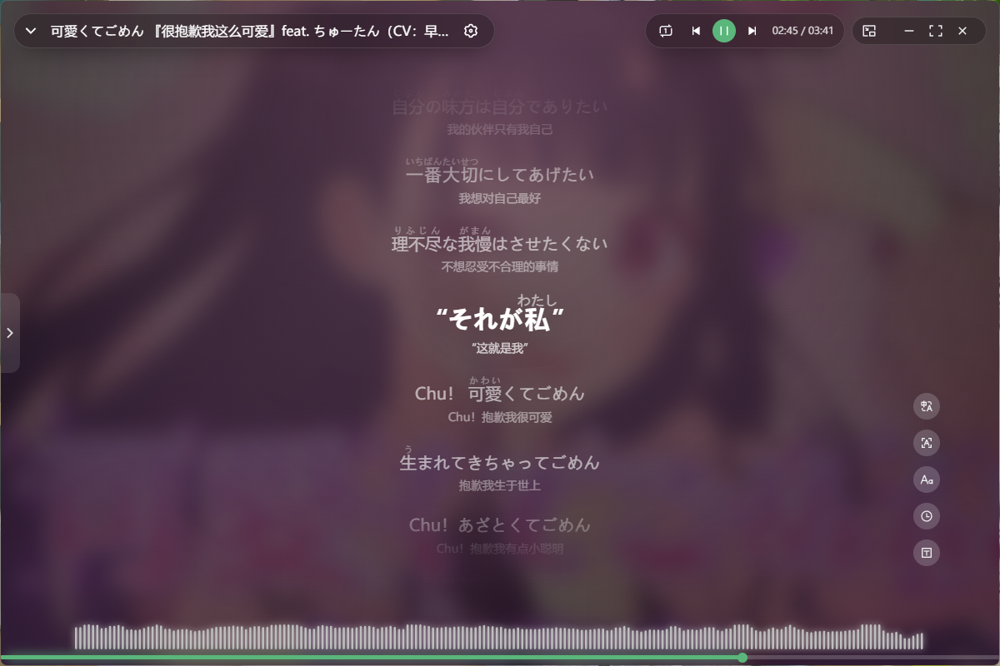
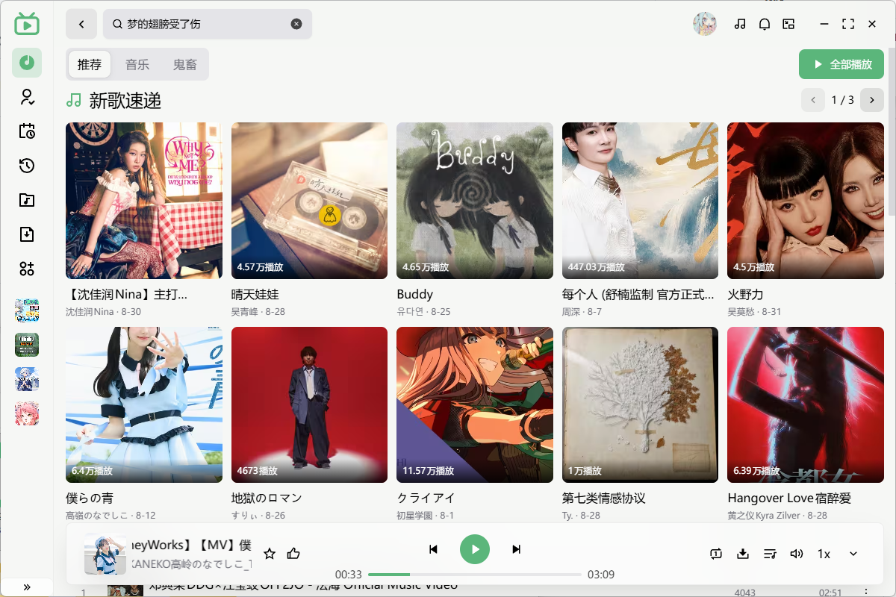
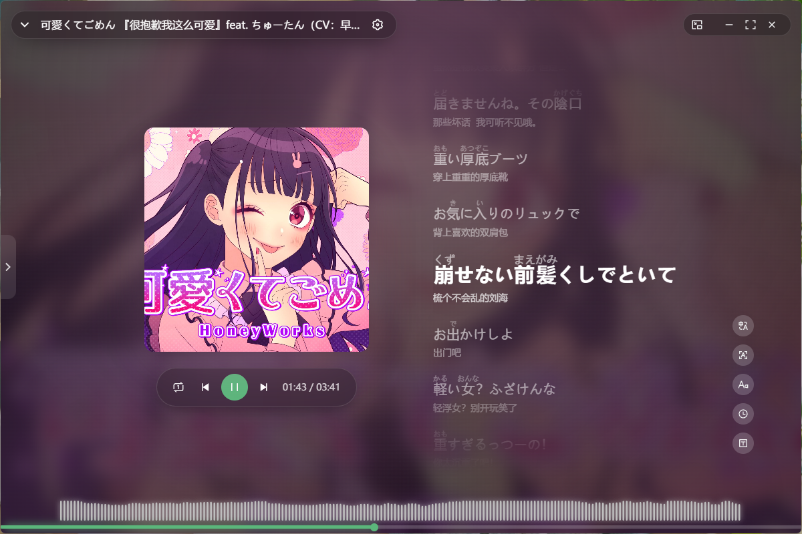
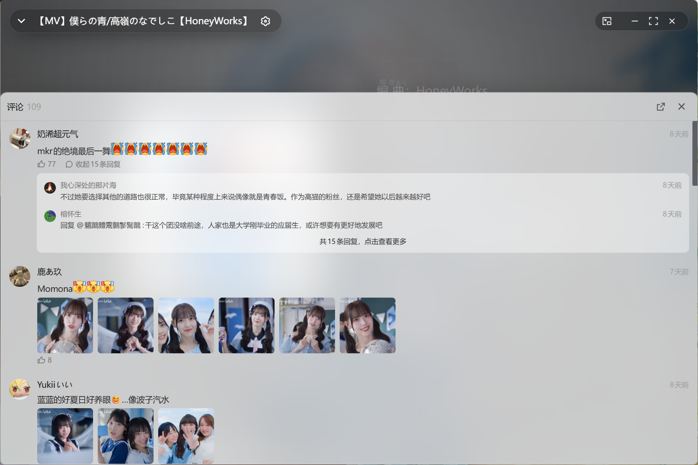
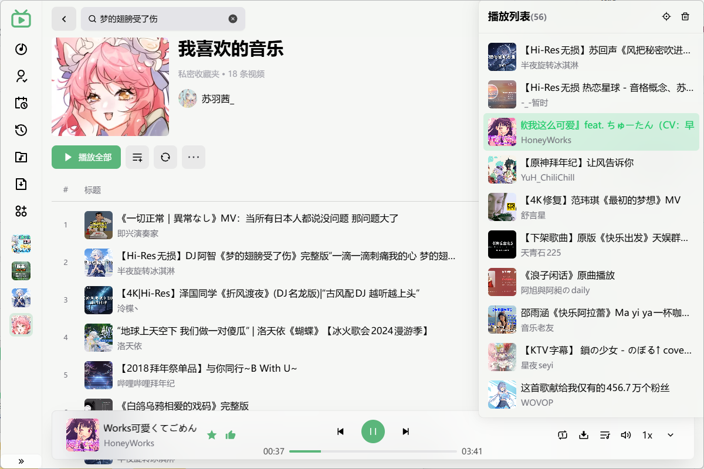
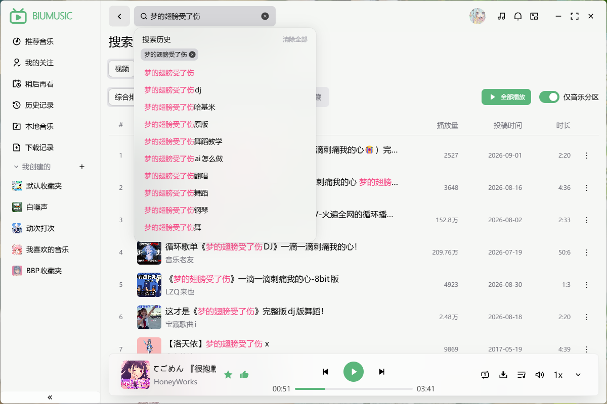
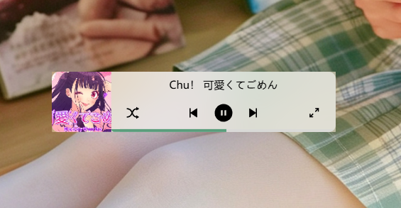
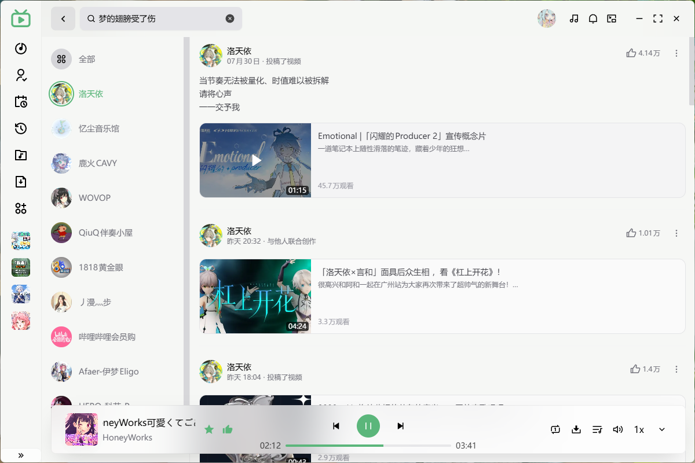
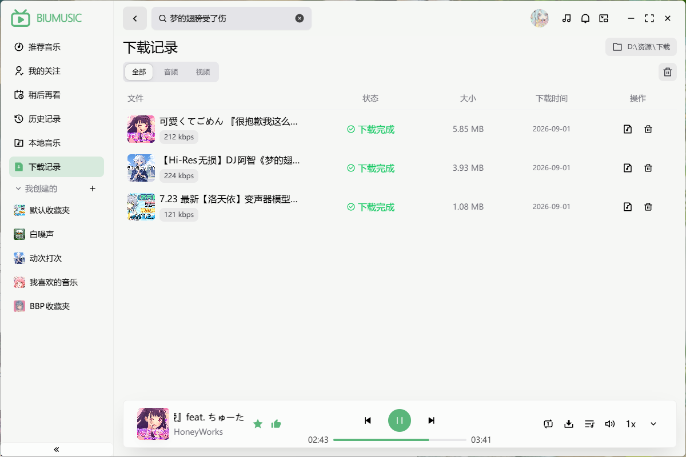
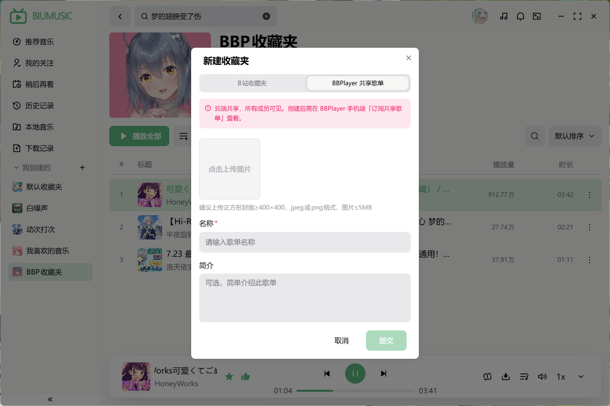

<div align="center">


# Biu 音乐播放器

**把 B 站变成你的桌面音乐库。**

每日推荐、收藏夹、私人 FM、无损音频，配上全屏歌词、假名注音、桌面歌词和迷你播放器。基于哔哩哔哩公开接口的跨平台桌面音乐播放器，非官方项目，与哔哩哔哩无任何官方关联或背书。

[](https://github.com/xRetia/biu/releases) [](https://github.com/xRetia/biu/releases/latest) [](./LICENSE)

[项目主页](./index.html) · [下载](#-下载) · [功能](#-特色功能) · [上手](#-上手) · [开发](#-从源码运行) · [更新日志](./CHANGELOG.md)

</div>

<br />

<table>
  <tr>
    <td width="50%" align="center"></td>
    <td width="50%" align="center"></td>
  </tr>
  <tr>
    <td width="50%" align="center"></td>
    <td width="50%" align="center"></td>
  </tr>
  <tr>
    <td width="50%" align="center"></td>
    <td width="50%" align="center"></td>
  </tr>
  <tr>
    <td width="50%" align="center"></td>
    <td width="50%" align="center"></td>
  </tr>
  <tr>
    <td width="50%" align="center"></td>
    <td width="50%" align="center"></td>
  </tr>
</table>

---

## ✨ 特色功能

**听与看**

- 全屏播放器：左封面右歌词，逐行聚焦滚动、当前行放大高亮，样式设置面板可自定义显示项
- 日文歌词假名注音（振假名），可开关、可调字号；桌面歌词同样显示注音，已唱部分一起换色
- 歌词翻译支持开关、字号调节与时间偏移微调；歌词多来源自动匹配，可手动搜索并缓存
- 音频实时频谱，窗口边缘还有一条随节拍走的七彩灯带
- 评论浏览：全屏播放器内直接看 B 站评论，支持楼中楼、图片放大、一键跳转

**随处可听**

- 桌面歌词：独立置顶透明窗，压在任意桌面上都清晰；默认整体鼠标穿透不挡点击，指针落到歌词上才出现控制工具条，可选单行 / 双行
- 迷你播放器：贴着屏幕边缘的小胶囊，实时歌词、溢出自动滚动，Windows 11 下使用系统亚克力材质
- 系统全局快捷键、托盘与最小化隐藏、macOS Dock 右键菜单
- 私人 FM、本地音乐页面、个人空间与歌手资料页

**音频与下载**

- 优先拉取更高码率音频（Hi-Res / FLAC / 192K），可在设置里选择音质偏好
- 视频文件与音频提取下载，收藏夹批量下载，支持断点续传
- 内置精简版 ffmpeg，无需额外安装即可提取音频，也可自定义 ffmpeg 路径

**界面与账号**

- 全局毛玻璃（Glassmorphism）界面：侧边栏、播放列表、右键菜单、弹窗面板均为主题感知毛玻璃
- 浅色 / 深色 / 跟随系统，可自定义主色与圆角；支持紧凑模式与播放栏折叠
- 「动画帧率上限」设置（30/60/90/120/144），频谱、背景虚化与灯带都受它约束，避免特效白吃显卡
- 密码登录与短信登录，全局接入极验风控；登录后可取收藏夹、稍后再看、历史记录、用户动态，支持点赞与一键三连
- BBPlayer 共享歌单：与手机端 BBPlayer 收藏夹双向兼容、云端同步
- 安装包支持自动检测更新；错误边界与反馈机制兜底

## 📥 下载

所有产物都在 **[GitHub Releases](https://github.com/xRetia/biu/releases/latest)**。文件名里的 `x64` 对应 Intel / AMD 机器，`arm64` 对应 Apple 芯片、骁龙本与多数 ARM 设备。

| 系统 | 推荐 | 什么时候选别的 |
| --- | --- | --- |
| Windows 10 / 11 | `Biu-<version>-win-setup-x64.exe`（NSIS 安装包，带开始菜单与自动更新） | 不想安装或没有管理员权限 → `win-portable`（免安装，应用内更新受限，需手动替换） |
| macOS 12+ | `Biu-<version>-mac-arm64.dmg`（Intel 机器选 `mac-x64.dmg`） | 脚本 / CI 分发 → `.zip`；首次打开被拦时在「系统设置 → 隐私与安全性」允许 |
| Linux | `Biu-<version>-linux-x64.AppImage`（`chmod +x` 后直接运行） | 习惯包管理器 → `.deb` / `.rpm`；Arch 用户 → AUR [`biu-bin`](https://aur.archlinux.org/packages/biu-bin) |

- **架构怎么选**：Windows 看「设置 → 系统 → 关于 → 系统类型」；macOS 按芯片（Apple 硅选 `arm64`，Intel 选 `x64`）；Linux 执行 `uname -m`，`x86_64` 对应 `x64`，`aarch64` 对应 `arm64`。
- **自动更新**：应用会定期检查 GitHub Releases 并提示更新；Windows 免安装版在应用内下载更新受限，建议到 Releases 手动下载替换。
- `latest.yml` 与 `*.blockmap` 是自动更新的辅助文件，手动下载时无需关注。

## 🚀 上手

1. 下载并安装对应系统的产物。
2. 在左下角头像处登录 B 站账号（密码或短信，走极验风控）。不登录也能用每日推荐、搜索与本地音乐，只是拿不到收藏夹和历史。
3. 点任意歌曲开始播放，双击封面或点左下角进入全屏播放器。
4. 想边干活边看词：播放栏右侧点「词」开启桌面歌词；需要小窗就点迷你播放器。
5. 播放栏上滚动鼠标滚轮直接调音量；全局快捷键可在窗口外切歌。

> 部分音频清晰度与解析需要登录或大会员权限。请遵循 Bilibili 使用条款，合理合规使用。

## 🛠 从源码运行

环境要求：Node `22.17.1`、pnpm `10.24.0`。

```bash
git clone https://github.com/xRetia/biu
cd biu
pnpm install

pnpm dev        # 起开发服务器并拉起 Electron
pnpm build      # 产出各平台安装包
pnpm test       # Vitest
pnpm knip       # 检查未使用的代码
```

技术栈：Electron 38 + React 19 + TypeScript 5.9（strict）+ Rsbuild + Tailwind CSS 4 + HeroUI + Zustand。

## 🤝 参与贡献

1. Fork 本仓库并创建分支：`feature/your-feature` / `fix/your-fix`。
2. 本地通过构建与基本自测（`pnpm dev`、`pnpm build`、`pnpm test`）。
3. 提交 PR，说明改动点与影响范围，必要时附截图。
4. CI 通过构建与审查后合入主分支。

代码风格由 ESLint 9 + Prettier + Stylelint 约束；提交信息使用约定式格式（`feat:` / `fix:` / `perf:` 等），由 husky + commitlint 校验。

## 📄 许可与声明

本项目以 [PolyForm Noncommercial License 1.0.0](./LICENSE)（SPDX：`PolyForm-Noncommercial-1.0.0`）发布。

- 仅供学习与研究，**禁止任何商业用途**（销售、收费服务、广告变现、商业集成等）。
- 与 Bilibili 无官方关联或背书，不使用其商标与标识；相关名称与商标归其权利人所有。
- 数据来源于用户调用的公开接口与个人账户授权；使用时须遵守 Bilibili《用户协议》《社区规则》及相关法律法规。
- 禁止绕过登录 / 会员权限、DRM 与加密措施，或进行批量爬取、恶意抓取等违反平台规则的行为。
- 如需商业授权，或涉及权利与合规问题，请通过 [Issues](https://github.com/xRetia/biu/issues) 反馈。

## 🙏 鸣谢

- [SocialSisterYi/bilibili-API-collect](https://github.com/SocialSisterYi/bilibili-API-collect)：哔哩哔哩接口的长期收集与整理，为本项目提供了重要参考（`CC-BY-NC 4.0`，仅用于学习与研究）。
- [@cjlworld](https://github.com/cjlworld)：为 Arch Linux 用户创建并维护 [AUR 软件包](https://aur.archlinux.org/packages/biu-bin)，`paru -S biu-bin` 即可安装更新。

## ❤️ Contributors

<a href="https://github.com/xRetia/biu/graphs/contributors">
  
</a>

## 🌟 Star History

[](https://www.star-history.com/#xRetia/biu&type=date&legend=top-left)

如果你喜欢这个项目，欢迎点个 ⭐️ 支持，也欢迎提出 Issue 交流与反馈。
